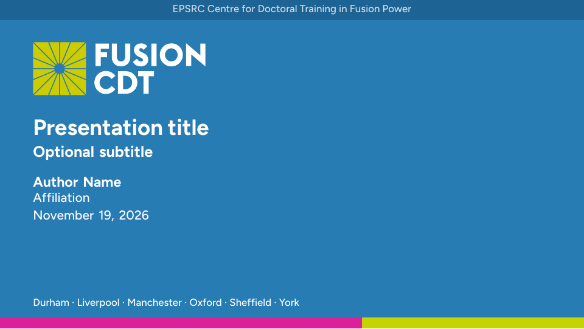
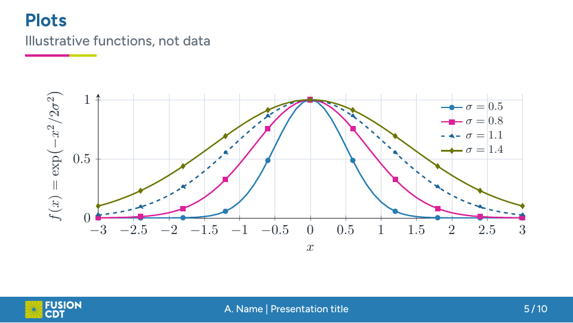

# Fusion CDT Beamer theme (unofficial)

> **Unofficial, community-maintained LaTeX Beamer template inspired by the Fusion CDT visual
> identity. This is not an official Fusion CDT template and is not endorsed by Fusion CDT or
> its partner institutions.**

A LuaLaTeX Beamer theme for students and researchers who want slides that match the look
of the website of the EPSRC Centre for Doctoral Training in Fusion Power
([fusion-cdt.ac.uk](https://fusion-cdt.ac.uk/)). It comes with a starter presentation to
copy and a demonstration of every feature.

| Title slide | Content slide |
|---|---|
|  |  |

## Features

- **Title, section and closing slides** in the website's blue, with the Fusion CDT logo,
  the website's dark-blue top strip and a magenta and lime stripe.
- **Content slides** with plenty of room: a white page, frame titles in the website's dark
  blue, and a slim blue footer with the logo, short author, short title and slide number.
- **Figtree**, the website's typeface, is bundled. Maths uses Latin Modern.
- **Lists, blocks, captions and the bibliography** are styled in the website palette.
- **Plots:** a `fusioncdt` pgfplots cycle list in the same colours, applied automatically.
- **Options** to skip the section slides or use the website's cream background.
- A **starter** presentation, a **demonstration**, a `make check` target and a GitHub Actions
  workflow.

The colours come from the Fusion CDT website. [docs/branding.md](docs/branding.md) records
every value and its source.

## Requirements

- **LuaLaTeX**, with the `beamer`, `fontspec` and `pgf` (TikZ) packages, plus `pgfplots` for
  the demonstration. Any recent TeX Live includes them. On Debian or Ubuntu:

  ```sh
  sudo apt install texlive-luatex texlive-latex-recommended texlive-pictures latexmk
  ```

- **latexmk**, and **make** for the one-command build.
- **curl** and **rsvg-convert**, once, to download the logo (see [Logo](#logo)).
  `rsvg-convert` is in the `librsvg2-bin` package on Debian/Ubuntu and `librsvg` on Homebrew.
- **ChkTeX**, only for `make check`.

Tested toolchain: Ubuntu 24.04 with its TeX Live 2023 packages (LuaHBTeX 1.17.0),
latexmk 4.83, ChkTeX 1.7.8 and rsvg-convert 2.58.0. Other systems, newer TeX Live releases,
MiKTeX and Overleaf have not been tested.

## Quick start

Clone the repository or download it as a ZIP, then build both example presentations
from its top folder:

```sh
cd fusion-cdt-beamer-unofficial
make
```

The first run downloads the logo. The results are `starter/main.pdf` and `demo/demo.pdf`.

## Start your own presentation

Copy the starter next to it, then build inside the copy:

```sh
cp -R starter my-talk
cd my-talk
latexmk
```

Edit `my-talk/main.tex`. `latexmk -pvc` rebuilds whenever you save, and `latexmk -C`
removes everything it generated. The `latexmkrc` file in the folder selects LuaLaTeX and
points TeX at `../theme/`, so keep the copy one level below the repository's top folder.
To keep it anywhere else, see [Using the theme outside this folder](#using-the-theme-outside-this-folder).

### Title slide and metadata

Set these in the preamble:

```latex
\title{Presentation title}
\subtitle{Optional subtitle}          % may be omitted
\author[A. Name]{Author Name}         % [short form] appears in the footer
\institute{Affiliation}               % may be omitted
\date{\today}                         % or a fixed date
```

For several authors, write `\author{First Author \and Second Author}`. The PDF's title and
author fields are filled in from `\title` and `\author`. Set any other field with
`\hypersetup`, for example `\hypersetup{pdfsubject={...}}`.

Then use `\fcdttitleframe` for the title slide, `\section{...}` for divider slides,
`\begin{frame}{Title}{Optional subtitle} ... \end{frame}` for content, and
`\fcdtclosingframe{Thank you}` at the end.

## Theme options and commands

Options go in square brackets: `\usetheme[cream]{FusionCDT}`.

| Option | Effect |
|---|---|
| `nosectionpages` | No automatic divider slide at each `\section`. Use `\fcdtsectionframe` to add one by hand. |
| `cream` | The website's off-white `#EEEEE6` as the background of content slides, instead of white. |

| Command | Effect |
|---|---|
| `\fcdttitleframe` | The title slide. |
| `\fcdtsectionframe` | A divider slide for the current section. |
| `\fcdtclosingframe{text}` | The closing slide, with *text* in large type, then author and affiliation. |
| `\fcdtsetstriptext{text}` | Text in the dark-blue strip of the blue slides. The default is "EPSRC Centre for Doctoral Training in Fusion Power"; `{}` leaves the strip empty. |
| `\fcdtsetpartners{text}` | Line at the bottom of the title slide. The default lists the six partner universities; `{}` hides it. |
| `\fcdtlogo{height}` | The logo at the given height. It has white lettering and transparent rays, so use it only on `fcdtBlue`. |
| `\fcdtassetdir{folder/}` | Folder containing `fusion-cdt-logo-white.pdf`, if it is not on the TeX search path. |

Colour names for your own content: `fcdtBlue`, `fcdtDarkBlue`, `fcdtPaleBlue`, `fcdtCream`,
`fcdtMagenta`, `fcdtLime`, `fcdtInk`, `fcdtGrey`, `fcdtLimeDark` and `fcdtMagentaText`. For
example, `\textcolor{fcdtDarkBlue}{...}`. Lime has too little contrast for text.

## Logo

This repository does **not** contain the Fusion CDT logo, because no licence for
redistributing it has been found (see [THIRD_PARTY_NOTICES.md](THIRD_PARTY_NOTICES.md)).
Instead, `make` runs [`scripts/fetch-logo.sh`](scripts/fetch-logo.sh) the first time. The
script downloads the logo published in the Fusion CDT GitHub organisation, at a fixed commit,
checks its SHA-256 checksum, and converts it unchanged to
`theme/logo/fusion-cdt-logo-white.pdf`. To run it on its own: `make logo`.

To do it by hand, for example on Windows:

1. Download
   <https://raw.githubusercontent.com/Fusion-CDT/community-reading-list/10d8632c7b40d5f75dc04bc34814a8ba4d85fa39/docs/images/fusion-cdt-logo-white.svg>.
2. Convert it to PDF without changing it, for example in Inkscape with *File → Save As… →
   PDF*.
3. Save the result as `theme/logo/fusion-cdt-logo-white.pdf`.

Without the file, presentations still compile, with a warning and no logo.

## Build the demonstration

```sh
make demo     # or: cd demo && latexmk
make check    # build both presentations, run ChkTeX and check the logs, as CI does
make clean    # remove generated files; keeps sources, fonts and the downloaded logo
```

`demo/demo.tex` shows lists, blocks, equations, a plot, a figure with a caption, a table,
citations with a bibliography, section slides and the closing slide. Its scientific content
is illustrative only.

## Using the theme outside this folder

Either point a presentation's `latexmkrc` at the theme folder, using an absolute path or a
path relative to the presentation:

```perl
ensure_path('TEXINPUTS', '/path/to/fusion-cdt-beamer-unofficial/theme//');
```

Or install the theme once into your personal TeX tree. Every document can then use
`\usetheme{FusionCDT}` without a `latexmkrc` file, as long as it is compiled with LuaLaTeX
(`latexmk -lualatex`):

```sh
make logo
dest="$(kpsewhich -var-value TEXMFHOME)/tex/latex/fusion-cdt-beamer-unofficial"
mkdir -p "$dest" && cp -R theme/. "$dest/"
```

To update an installed copy, run the same commands again. To remove it, delete `$dest`.

## Repository structure

```text
fusion-cdt-beamer-unofficial/
├── theme/                      the theme: everything a presentation needs
│   ├── beamerthemeFusionCDT.sty
│   ├── fonts/                  Figtree (SIL Open Font License 1.1)
│   └── logo/                   the downloaded logo goes here (not in the repository)
├── starter/                    minimal presentation to copy (main.tex, latexmkrc)
├── demo/                       demonstration of all features (demo.tex, references.bib, latexmkrc)
├── scripts/
│   ├── fetch-logo.sh           downloads and converts the logo
│   └── check-logs.sh           fails on warnings that do not stop the build
├── docs/
│   ├── branding.md             colour values and their sources
│   └── images/                 preview images for this README
├── .github/                    CI workflow, issue and pull-request templates
├── Makefile
├── LICENSE                     MIT, for the theme code and documentation
└── THIRD_PARTY_NOTICES.md      logo, typeface and branding
```

## Troubleshooting

| Problem | Fix |
|---|---|
| Warning *Figtree font files not found on the TeX search path* | TeX cannot see `theme/`. Build with `latexmk` inside a folder whose `latexmkrc` points at `theme/`, or install the theme as described above. |
| Warning *Figtree is only loaded under LuaLaTeX* | Your editor ran pdfLaTeX or XeLaTeX. Set it to run `latexmk`, which reads `latexmkrc`, or select LuaLaTeX. |
| Warning *Logo file fusion-cdt-logo-white.pdf not found* | Run `make logo`, or follow the manual steps under [Logo](#logo). |
| *fetch-logo: 'rsvg-convert' is required* | Install it: `sudo apt install librsvg2-bin` on Debian/Ubuntu, `brew install librsvg` on macOS. |
| *fetch-logo: checksum mismatch* | The downloaded file is not the expected logo. Do not use it; please open an issue. |
| Citations show as **?** | Run `latexmk`, which runs BibTeX as often as needed, and not `lualatex` alone. |
| The first build is slow | LuaLaTeX builds its font cache on the first run; later runs are faster. |
| No `make` (for example on Windows) | Run `latexmk` inside `starter/`, `demo/` or your own folder, and get the logo by hand. |

## Contributing and reporting bugs

Bug reports and improvements are welcome; see [CONTRIBUTING.md](CONTRIBUTING.md). When you
report a problem, please reduce it to a small example with placeholder content. Do not
attach or paste a private presentation.

## Licence and attribution

- **Theme code, scripts and documentation:** MIT licence, see [LICENSE](LICENSE). Copyright
  2026 the fusion-cdt-beamer-unofficial contributors.
- **Starter and demonstration presentations** (`starter/`, `demo/`): dedicated to the public
  domain under [CC0 1.0](https://creativecommons.org/publicdomain/zero/1.0/). Presentations
  you build from them need no licence notice or attribution.
- **Figtree typeface** (`theme/fonts/`): Copyright 2022 The Figtree Project Authors, SIL
  Open Font License 1.1 ([theme/fonts/OFL.txt](theme/fonts/OFL.txt)).
- **Fusion CDT logo, name and visual identity:** not covered by any licence in this
  repository. The logo is not distributed here. See
  [THIRD_PARTY_NOTICES.md](THIRD_PARTY_NOTICES.md), including the open questions listed there.

The placeholder presenter "Author Name" in the examples is not an author of this project.

## Limitations

- Figtree is used only with LuaLaTeX. pdfLaTeX and XeLaTeX compile the slides in Latin Modern
  Sans and print a warning.
- Only the toolchain listed under [Requirements](#requirements) has been tested.
- The design is made for 16:9 slides (`aspectratio=169`). Other aspect ratios are untested.
- The logo needs a one-time download with `curl` and `rsvg-convert`, or the manual steps.
- No official Fusion CDT brand guidelines or presentation template were found. The colours
  are those used on the website ([docs/branding.md](docs/branding.md)). The partner
  universities are those listed on the website in November 2026.
